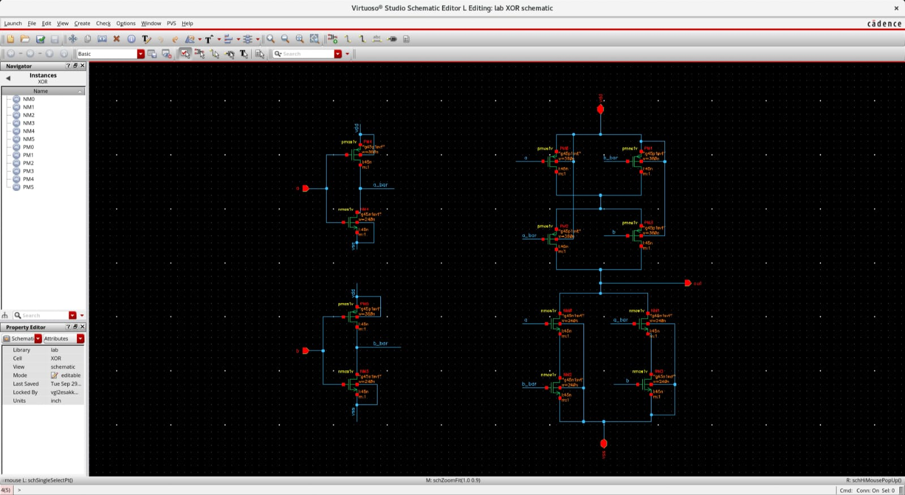
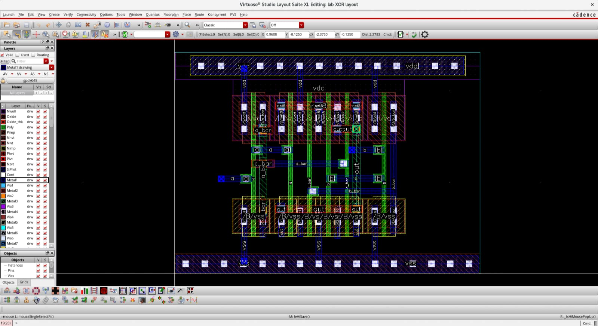
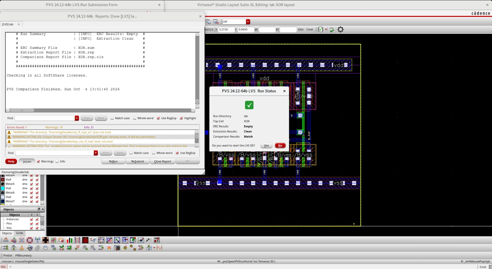
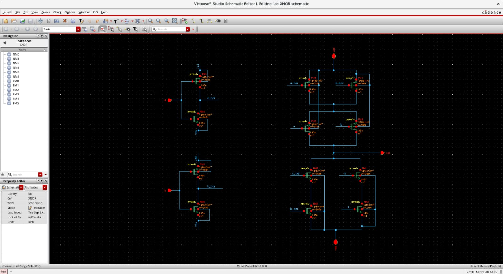
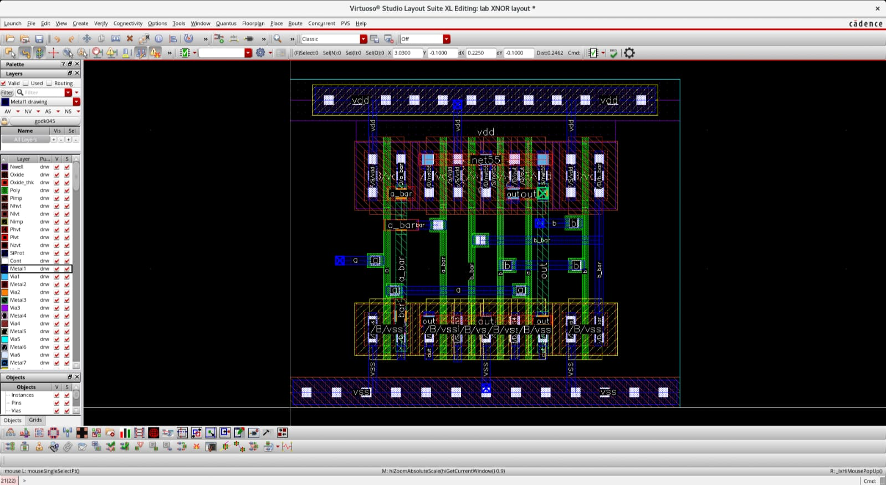
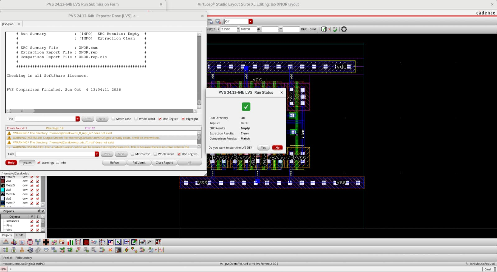

# XOR and XNOR Layout Design

## Project Overview

Designed and implemented transistor-level CMOS schematics and custom
layouts for XOR and XNOR logic gates. The designs were completed and
verified using Synopsys EDA tools.

## Tools and Technology

-   **Design Tool:** Synopsys Custom Compiler
-   **PDK:** SAED_32_28_PDK
-   **Verification Tool:** Synopsys IC Validator

------------------------------------------------------------------------

# XOR Gate

## 1. Schematic

-   Developed the transistor-level CMOS schematic to implement XOR logic
    functionality.
-   Designed the PMOS pull-up and NMOS pull-down networks.
-   Incorporated complementary input signals to achieve the required
    logic operation.

## 2. Layout

-   Implemented the custom layout with symmetrical device placement and
    routing.
-   Followed device-matching principles to maintain layout consistency.
-   Organized interconnections to achieve clear and efficient signal
    routing.
-   Implemented VDD and VSS power rails for reliable power connectivity.

## 3. Verification

-   Performed Layout Versus Schematic (LVS) verification using Synopsys
    IC Validator.
-   Achieved a successful LVS comparison, confirming that the layout
    matches the schematic.
-   Confirmed clean extraction results.
-   ERC results reported as empty in the verification run.

------------------------------------------------------------------------

# XNOR Gate

## 1. Schematic

-   Developed the transistor-level CMOS schematic to implement XNOR
    logic functionality.
-   Designed the PMOS pull-up and NMOS pull-down networks.
-   Incorporated complementary input signals to achieve the required
    logic operation.

## 2. Layout

-   Implemented the custom layout with symmetrical device placement and
    routing.
-   Followed device-matching principles to maintain layout consistency.
-   Organized interconnections to achieve clear and efficient signal
    routing.
-   Implemented VDD and VSS power rails for reliable power connectivity.

## 3. Verification

-   Performed Layout Versus Schematic (LVS) verification using Synopsys
    IC Validator.
-   Achieved a successful LVS comparison, confirming that the layout
    matches the schematic.
-   Confirmed clean extraction results.
-   ERC results reported as empty in the verification run.

------------------------------------------------------------------------

## Project Outcome

Successfully completed the schematic design, custom layout
implementation, and LVS verification of XOR and XNOR logic gates using
Synopsys Custom Compiler and Synopsys IC Validator.

## Author

**Esakkiraj G**
B.E. Electronics and Communication Engineering
Custom & Analog Layout Trainee

**Domain:** VLSI | Custom Layout | Analog Layout | CMOS Design
